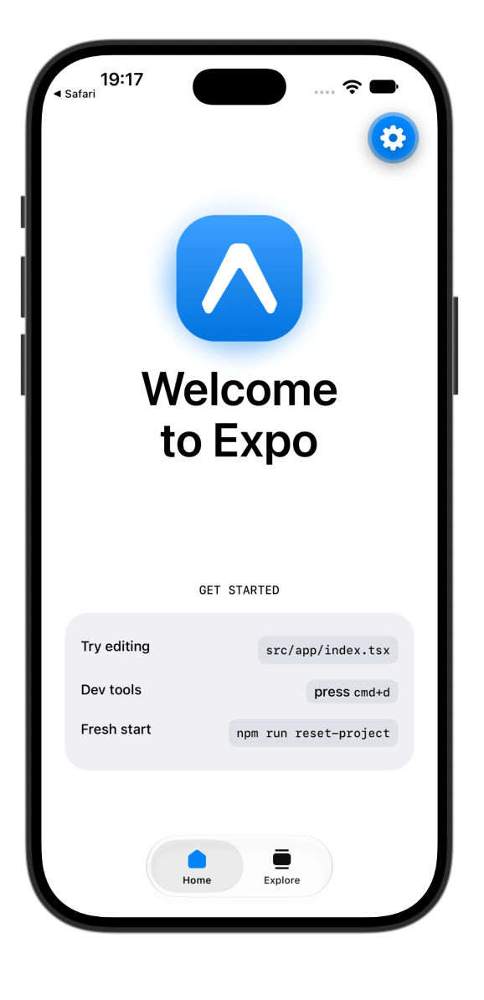
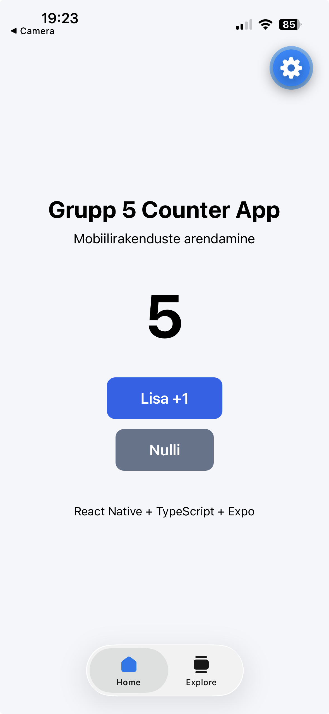
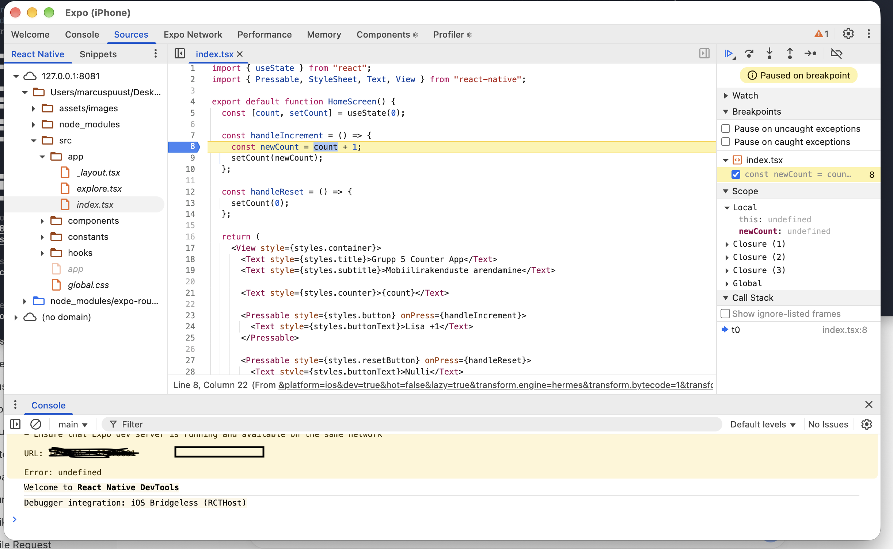
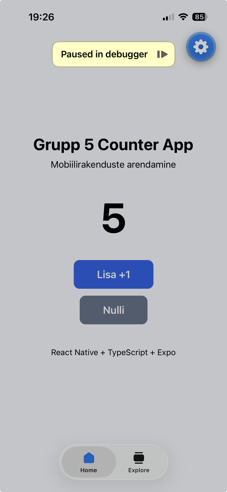

# Grupp 5 – React Native / Expo testprojekt

Tallinna Ülikooli aine **Mobiilirakenduste arendamine** kodune grupitöö **S13**.

Eesmärk oli luua React Native / Expo projekt, muuta algset malli ning kontrollida rakenduse töötamist simulaatoris, füüsilises seadmes ja debuggeriga.

## Autorid

- Marcus Puust
- Jan Aaron Einloo
- Rico Paum
- Rene Pruul
- Karl Luberg
- Armin Jaemaa

## Tehnoloogiad

- Expo SDK 57
- React Native 0.86.3
- TypeScript 6.0.3
- Expo Router
- React
- Node.js / npm
- Git / GitHub

Testitud: **macOS, Xcode 27.0, iOS 27.0 Simulator, Expo Go ja füüsiline iPhone**.

> Androidi ja Windowsi käivitamisjuhised on lisatud, kuid neid keskkondi selle töö käigus ei testitud.

---

## Seadistamine

Vajalikud on **Node.js, npm ja Git**.

```bash
git clone https://github.com/MarcusPuust/Grupp5TestApp.git
cd Grupp5TestApp
npm install
npx expo start --lan
```

Soovi korral saab projekti kontrollida:

```bash
npx expo-doctor
```

Meie projekt läbis Expo Doctori kontrollid edukalt.

### iOS – macOS

iOS Simulatori jaoks on vajalik Xcode ja iOS Simulator runtime.

Pärast Expo käivitamist vajuta terminalis:

```text
i
```

Füüsilise iPhone'i puhul paigalda **Expo Go**, ühenda telefon ja arvuti samasse võrku ning skaneeri terminalis olev QR-kood.

### Android – macOS / Windows

Android Emulatori jaoks paigalda **Android Studio, Android SDK ja Android Virtual Device (AVD)**.

Pärast emulaatori käivitamist vajuta Expo terminalis:

```text
a
```

Füüsilise Androidi puhul paigalda **Expo Go** ja skaneeri terminalis olev QR-kood.

> iOS Simulator töötab ainult macOS-is.

---

## Muudatus algses mallis

Muutsime faili:

```text
src/app/index.tsx
```

Algse avalehe asemele tegime **Grupp 5 Counter App** rakenduse, millel on loendur ning nupud `Lisa +1` ja `Nulli`.

Loenduri suurendamiseks lisasime enda funktsiooni:

```tsx
const handleIncrement = () => {
  const newCount = count + 1;
  setCount(newCount);
};
```

Muudatus on rakenduses nähtav ning algne mall ja meie muudatus on Git-ajaloos eraldi commit'ides.

---

## Testimine

### iOS Simulator

Rakendust testiti **iOS 27.0 Simulatoris**. Kontrollisime rakenduse käivitumist ning mõlema nupu töötamist.



### Füüsiline iPhone

Sama projekt käivitati **Expo Go** abil füüsilisel iPhone'il. Kontrollisime rakenduse käivitumist ja loenduri töötamist.



### Debugger ja breakpoint

React Native DevToolsis lisasime breakpoint'i enda `handleIncrement` funktsiooni reale:

```tsx
const newCount = count + 1;
```

Füüsilises iPhone'is `Lisa +1` vajutamisel peatus rakendus breakpoint'is ja telefonis kuvati `Paused in debugger`.





---

## Probleemid ja lahendused

### Expo ja React Native versioonid

Algselt soovisime kasutada React Native 0.87, kuid Expo versioonidega tekkisid ühilduvusprobleemid. Lõplikult kasutasime **Expo SDK 57, React Native 0.86.3 ja TypeScript 6.0.3**.

### Metro Bundleri ühendus

Simulatoris avanes Expo Go, kuid Metro serveriga ei saadud ühendust.

`--localhost` režiimis kuulas Metro ainult:

```text
[::1]:8081
```

Lahenduseks oli Expo käivitamine LAN-režiimis:

```bash
npx expo start --lan --clear
```

Pärast seda kuulas Metro `*:8081` ning Simulator sai projektiga ühenduse.

### Füüsiline iPhone ja debugger

Expo Go kasutamiseks logisime telefonis sisse sama Expo kontoga. Seejärel avanes projekt QR-koodiga.

React Native DevToolsis lisatud breakpoint peatas füüsilises telefonis töötava rakenduse edukalt.

---

## Refleksioon

React Native'i ja TypeScripti koodi muutmine oli lihtne ning Expo Fast Refresh tegi muudatuste kontrollimise kiireks.

Kõige keerulisem oli Simulatori ja Metro Bundleri ühenduse seadistamine. Probleemi lahendamiseks kontrollisime eraldi Metro serverit, porti 8081 ja Simulatori võrguühendust. Lahenduseks osutus `--lan` režiimi kasutamine.

Töö käigus saime praktilise kogemuse Expo, React Native'i, iOS Simulatori, füüsilise iPhone'i ja debuggeriga. Samuti nägime, et rakenduse töötamist tuleb kontrollida eraldi nii virtuaalses kui ka füüsilises seadmes.

---

# AR-leht – kodutöö S06

Uus leht **☰ → Liitreaalsus (AR)** paigutab 3D-mudeli **Tung Tung Tung Sahur** ([Eks.Art, Sketchfab, CC BY 4.0](https://sketchfab.com/3d-models/tung-tung-tung-sahur-91ddd9079bd84019ba4a12e01d93a0d6)) päris pinnale. Nupp avab mudeli süsteemi AR-vaaturis: iOS-is **AR Quick Look** (ARKit, `.usdz`), Androidis **Scene Viewer** (ARCore, `.glb`). Pinna tuvastuse ja žestid teeb vaatur ise, seega native-koodi pole vaja ja kõik töötab Expo Go's.

**Muudatused (94 rida, ~2,9% koodist):** `src/app/ar/index.tsx` (uus leht), `src/components/side-menu.tsx` (menüüpunkt), `assets/models/` (mudelid).

**Käivitamine iPhone'is:** `npx expo start --tunnel` → skaneeri QR-kood → Expo Go → AR-leht → **Ava AR-is**. Simulaatoris AR-i testida ei saa, sest seal puudub kaamera.

**Kontrollimine:** `tsc`, `expo lint`, `expo export --platform ios` ja `curl`-iga mudelifailide MIME-tüübid; AR-i ennast testisime füüsilises iPhone'is.

**Keeruline oli:**
- Native AR-teegid vajavad development buildi, mis iPhone'i jaoks nõuab tasulist Apple'i kontot, seega valisime süsteemi AR-vaaturi.
- AR Quick Look vajab MIME-tüüpi `model/vnd.usdz+zip`, mida GitHubi raw-lingid ei saada. Mudeleid jagame **jsDelivr** CDN-i kaudu.
- Windowsis jäi Expo Go laadima, sest tulemüür blokeeris Node.js-i Public-võrgus. Aitas `--tunnel`.
- `--tunnel` ei leidnud globaalselt paigaldatud `@expo/ngrok`-i. Aitas `npm install --no-save @expo/ngrok@^4.1.0`.

**Lihtne oli** lehe enda tegemine: Expo Routeris piisas ühest uuest failist ja AR-i osa koodis on vaid paar rida.

---
